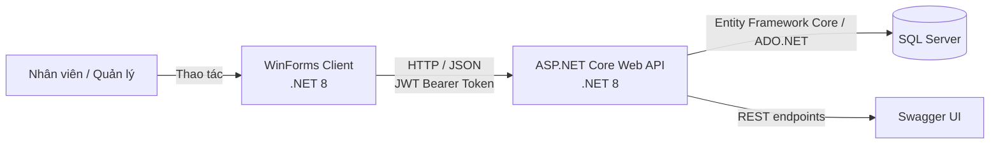

# 🛒 Mini Supermarket Management System

> Ứng dụng quản lý cửa hàng tiện lợi theo mô hình Client–Server, gồm Web API xử lý nghiệp vụ và ứng dụng Windows Forms dành cho nhân viên cửa hàng.


## Giới thiệu

Dự án xây dựng hệ thống quản lý cửa hàng tiện lợi với các nghiệp vụ bán hàng tại quầy, quản lý hàng hóa và khách hàng, theo dõi hóa đơn, phân quyền người dùng và xem báo cáo. Dữ liệu được lưu trong SQL Server; WinForms gọi Web API qua HTTP và nhận kết quả dạng JSON.

## Kiến trúc hệ thống



- **Client:** ứng dụng Windows Forms hiển thị giao diện, gửi yêu cầu và trình bày kết quả cho người dùng.
- **Server:** ASP.NET Core Web API xác thực JWT, kiểm tra quyền, thực hiện nghiệp vụ và truy cập dữ liệu.
- **Database:** SQL Server lưu người dùng, danh mục, sản phẩm, khách hàng, hóa đơn và chi tiết hóa đơn.
- **Giao tiếp:** REST API qua HTTP; các API cần đăng nhập nhận Bearer Token trong header.

## Chức năng chính

- Đăng nhập, lưu token trong phiên chạy và kiểm soát quyền theo vai trò.
- Quản lý sản phẩm, danh mục, khách hàng, tài khoản và hóa đơn; hỗ trợ tìm kiếm, phân trang ở các màn hình danh sách.
- Bán hàng POS: quét/nhập mã vạch, cộng dồn sản phẩm, tính tổng tiền, nhận tiền khách và tính tiền thừa.
- Tích điểm khách hàng và đổi điểm thưởng khi thanh toán; thao tác thanh toán và cập nhật điểm được xử lý trong transaction.
- Cảnh báo sản phẩm sắp hết hàng khi tồn kho không quá 10.
- Dashboard KPI, biểu đồ doanh thu theo ngày, thống kê Top 5 sản phẩm bán chạy.
- Xuất báo cáo doanh thu và danh sách sản phẩm ra tệp Excel/CSV.
- Dùng chung `ApiClientService` để gọi API và gửi JWT Bearer Token.

### Vai trò sử dụng

| Vai trò | Quyền nghiệp vụ chính |
| --- | --- |
| **Admin / Quản lý** | Toàn quyền quản trị, tài khoản, báo cáo và các nghiệp vụ cửa hàng. |
| **Cashier / Thu ngân** | Bán hàng POS; xem sản phẩm, khách hàng, hóa đơn; thêm/cập nhật khách hàng; không xóa khách hàng và không thêm/sửa/xóa sản phẩm. |
| **Warehouse / Quản lý kho** | Tra cứu và quản lý danh mục, sản phẩm, tồn kho theo quyền API. |

Quyền thực tế được kiểm tra tại API, không chỉ dựa vào việc ẩn nút trên giao diện.

## Công nghệ sử dụng

| Thành phần | Công nghệ |
| --- | --- |
| Ngôn ngữ | C# |
| Backend | ASP.NET Core Web API, .NET 8 |
| Frontend | Windows Forms, .NET 8 for Windows |
| Cơ sở dữ liệu | Microsoft SQL Server |
| Truy cập dữ liệu | Entity Framework Core, LINQ, ADO.NET |
| Xác thực | JWT Bearer Authentication, role-based authorization |
| API docs | Swagger / Swashbuckle |
| Biểu đồ | `System.Windows.Forms.DataVisualization.Charting` |
| Xuất báo cáo | Excel/CSV từ ứng dụng WinForms |

## Cấu trúc Solution

```text
MiniSuperMarket_LeThanhHoang/
├── MiniSuperMarket_LeThanhHoang.sln
├── MiniSupermarket.API/
│   ├── Controllers/       # API đăng nhập, sản phẩm, khách hàng, đơn hàng, báo cáo...
│   ├── Data/              # DbContext, cấu hình và dữ liệu mẫu
│   ├── DTOs/              # Dữ liệu request/response theo nghiệp vụ
│   ├── Migrations/        # Lịch sử thay đổi cấu trúc cơ sở dữ liệu
│   ├── Models/            # Entity/domain model
│   ├── Properties/        # Cấu hình chạy API
│   └── Scripts/           # Stored procedure phục vụ báo cáo
├── MiniSupermaket.WinForms/
│   ├── Services/           # Gọi API và xuất bảng tính
│   ├── DTOs/               # Model nhận dữ liệu từ API
│   ├── Properties/         # Tài nguyên ứng dụng
│   └── Form*.cs            # Đăng nhập, shell, POS và màn hình quản lý
├── HinhAnh_BaoCao/         # Hình ảnh minh họa báo cáo đồ án
├── .gitignore
└── README.md
```

## Yêu cầu môi trường

- Windows 10/11.
- [.NET 8 SDK](https://dotnet.microsoft.com/download/dotnet/8.0).
- SQL Server hoặc SQL Server Express đang chạy trên máy.
- Visual Studio 2022 (workload **.NET desktop development** và **ASP.NET and web development**) hoặc PowerShell với .NET SDK.
- SQL Server Management Studio (SSMS) là tùy chọn, hữu ích khi kiểm tra dữ liệu.

## Cài đặt cơ sở dữ liệu

1. Mở `MiniSupermarket.API/appsettings.json` và kiểm tra `ConnectionStrings:DefaultConnection`. Cấu hình mặc định dùng SQL Server cục bộ với Windows Authentication và database `ThanhHoang_MiniSupermarketDb`.
2. Nếu SQL Server của bạn dùng instance khác, cập nhật connection string. Ví dụ SQL Server Express:

   ```json
   "DefaultConnection": "Server=localhost\\SQLEXPRESS;Database=ThanhHoang_MiniSupermarketDb;Trusted_Connection=True;TrustServerCertificate=True;"
   ```

3. Mở PowerShell tại thư mục gốc solution, cài công cụ EF nếu máy chưa có:

   ```powershell
   dotnet tool install --global dotnet-ef --version 8.0.31
   ```

   Nếu đã cài `dotnet-ef`, dùng `dotnet tool update --global dotnet-ef --version 8.0.31`.

4. Tạo/cập nhật database từ migrations:

   ```powershell
   cd MiniSupermarket.API
   dotnet restore
   dotnet ef database update
   ```

Migrations sẽ tạo cấu trúc bảng và dữ liệu khởi tạo được khai báo trong dự án. Hãy dùng database thử nghiệm khi thực hành thanh toán vì thao tác này tạo hóa đơn và cập nhật tồn kho/điểm thưởng.

Để bật đầy đủ báo cáo dùng stored procedure, mở và thực thi hai script `MiniSupermarket.API/Scripts/sp_GetDailyRevenue.sql` và `MiniSupermarket.API/Scripts/sp_GetRevenueByCashier.sql` trong SSMS sau khi database đã được tạo.

## Chạy Backend (Web API)

Mở PowerShell ở thư mục gốc solution:

```powershell
cd MiniSupermarket.API
dotnet restore
dotnet run --launch-profile http
```

API chạy tại `http://localhost:5055`; Swagger tại [http://localhost:5055/swagger](http://localhost:5055/swagger). Giữ cửa sổ này mở trong khi chạy WinForms. Profile `http` được dùng vì địa chỉ API mặc định của WinForms là `http://localhost:5055/api/`.

## Chạy Frontend (WinForms)

Mở một cửa sổ PowerShell khác tại thư mục gốc solution:

```powershell
cd MiniSupermaket.WinForms
dotnet restore
dotnet run
```

Hoặc mở `MiniSuperMarket_LeThanhHoang.sln` trong Visual Studio 2022, đặt `MiniSupermarket.API` và `MiniSupermarket.WinForms` làm startup projects cùng lúc; trước đó cần cập nhật database và đảm bảo API sử dụng cổng `5055`.

## Tài khoản demo và kiểm thử thủ công

Các tài khoản mẫu được khai báo trong dữ liệu khởi tạo của dự án:

| Vai trò | Tài khoản | Mật khẩu demo |
| --- | --- | --- |
| Quản lý | `admin01` | `123456` |
| Thu ngân | `cashier01` | `123456` |
| Kho | `ware01` | `123456` |

Đây là tài khoản phục vụ chạy thử đồ án. Hãy đổi mật khẩu và cấu hình khóa JWT riêng trước khi triển khai thực tế; không dùng thông tin demo cho dữ liệu hoặc môi trường thật.

### Quy trình kiểm tra nhanh

1. Chạy API và xác nhận Swagger mở được.
2. Chạy WinForms, đăng nhập lần lượt bằng các vai trò demo và kiểm tra quyền trên giao diện.
3. Thử tìm kiếm/phân trang sản phẩm, danh mục, khách hàng, hóa đơn và tài khoản theo vai trò.
4. Trên POS, thử quét mã vạch, tăng số lượng, tra cứu khách hàng, đổi điểm và thanh toán bằng database thử nghiệm.
5. Đăng nhập quản lý để kiểm tra KPI, bộ lọc ngày, biểu đồ, Top 5 và tải báo cáo Excel/CSV.
6. Kiểm tra cảnh báo hàng tồn thấp với sản phẩm có tồn kho `<= 10`.

Kiểm tra tính năng thanh toán làm thay đổi dữ liệu. Dùng database thử nghiệm và ghi lại dữ liệu cần phục hồi trước khi chạy các kịch bản.

### Build Solution

Từ thư mục gốc:

```powershell
dotnet restore MiniSuperMarket_LeThanhHoang.sln
dotnet build MiniSuperMarket_LeThanhHoang.sln
```

## Git và `.gitignore`

`.gitignore` loại trừ các thư mục đầu ra và phụ thuộc được tạo tự động như `bin/`, `obj/`, `node_modules/`, cùng cache của Visual Studio. Không commit các thư mục build/dependency này; mã nguồn, file solution, migrations và scripts cần thiết vẫn được quản lý bằng Git.

Nếu các thư mục build đã từng được Git theo dõi từ trước, `.gitignore` không tự gỡ chúng khỏi index. Sau khi kiểm tra kết quả `git ls-files`, có thể bỏ theo dõi bằng:

```powershell
git rm -r --cached --ignore-unmatch -- ':(glob)**/bin/**' ':(glob)**/obj/**' ':(glob)**/node_modules/**'
```

Lệnh trên chỉ gỡ khỏi Git index, không xóa các thư mục khỏi máy.

## Tác giả

**Lê Thanh Hoàng**

Đồ án: **Phần mềm Quản lý Cửa hàng Tiện lợi – Tạp hóa Phố Thị**

Repository: [MiniSuperMarket_LeThanhHoang](https://github.com/thanhhoang8123/MiniSuperMarket_LeThanhHoang)

---

README này mô tả cách cài đặt và chạy phiên bản mã nguồn trong repository. Khi thay đổi cổng API, SQL Server instance hoặc cấu hình xác thực, hãy cập nhật hướng dẫn tương ứng để người khác có thể tái hiện môi trường.
