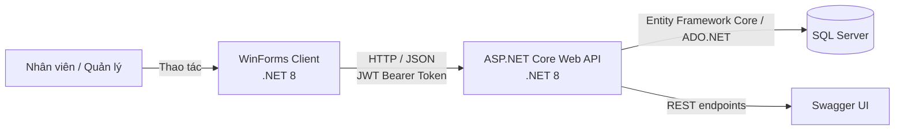

# 🛒 HỆ THỐNG QUẢN LÝ SIÊU THỊ MINI

> **Tên tiếng Anh:** Mini Supermarket Management System
>
> **Môn học:** Lập trình Ứng dụng .NET Core · **Mã môn:** 229162
>
> **Đề tài:** Phần mềm Quản lý Cửa hàng Tiện lợi – Tạp hóa Phố Thị
>
> **Kiến trúc:** Client–Server · **Nền tảng:** .NET 8


## 📖 1. Giới thiệu

Dự án xây dựng hệ thống quản lý cửa hàng tiện lợi với các nghiệp vụ bán hàng tại quầy, quản lý hàng hóa và khách hàng, theo dõi hóa đơn, phân quyền người dùng và xem báo cáo. Dữ liệu được lưu trong SQL Server; WinForms gọi Web API qua HTTP và nhận kết quả dạng JSON.

Đây là phiên bản tổng hợp của đồ án, kết hợp ứng dụng WinForms với Web API và SQL Server để phục vụ các nghiệp vụ bán hàng và quản lý cửa hàng. README mô tả mã nguồn hiện có trong repository, thay vì giới hạn ở nội dung của một buổi thực hành riêng lẻ.

## 🏗️ 2. Mô hình kiến trúc hệ thống (Client–Server)



- **Client:** ứng dụng Windows Forms hiển thị giao diện, gửi yêu cầu và trình bày kết quả cho người dùng.
- **Server:** ASP.NET Core Web API xác thực JWT, kiểm tra quyền, thực hiện nghiệp vụ và truy cập dữ liệu.
- **Database:** SQL Server lưu người dùng, danh mục, sản phẩm, khách hàng, hóa đơn và chi tiết hóa đơn.
- **Giao tiếp:** REST API qua HTTP; các API cần đăng nhập nhận Bearer Token trong header.

## ✨ 3. Nội dung và chức năng đã thực hiện

| | Chức năng |
|:--:|---|
| 🧭 | **Giao diện Shell** — menu điều hướng, tiêu đề và vùng làm việc trung tâm; màn hình con nạp trong vùng làm việc. |
| 🔐 | **Đăng nhập & phân quyền** — lấy token qua API, áp dụng quyền theo vai trò; `ApiClientService` gửi JWT Bearer Token. |
| 📦 | **Quản lý dữ liệu** — lưới sản phẩm tải từ API, thao tác thêm/sửa/xóa theo quyền; quản lý danh mục, khách hàng, tài khoản và hóa đơn với tìm kiếm và phân trang. |
| 👥 | **Vai trò thu ngân** — xem sản phẩm/khách hàng/đơn hàng, thêm và sửa khách hàng; không xóa khách hàng hoặc chỉnh sửa sản phẩm. |
| 🛒 | **Bán hàng POS** — quét mã vạch, cộng dồn số lượng, tính tổng tiền và tiền thừa. |
| ⭐ | **Tích điểm & đổi điểm** — cập nhật điểm thưởng khi thanh toán trong transaction. |
| ⚠️ | **Cảnh báo tồn kho** — làm nổi bật mặt hàng có tồn kho không quá 10. |
| 📊 | **Báo cáo** — 4 thẻ KPI (doanh thu hôm nay, tổng hóa đơn, khách hàng mới, mặt hàng sắp hết), biểu đồ doanh thu theo ngày trong khoảng thời gian chọn, Top 5 sản phẩm bán chạy và xuất Excel/CSV danh sách sản phẩm, hóa đơn, doanh thu. |
| 💬 | **Thông báo dễ hiểu** — hiển thị lỗi bằng tiếng Việt khi dữ liệu không hợp lệ hoặc dịch vụ không sẵn sàng. |

> **Phạm vi biểu đồ:** phiên bản hiện tại cho phép chọn ngày bắt đầu/kết thúc và so sánh doanh thu theo từng ngày trong khoảng đã chọn. Chưa có nút chuyển riêng để gom dữ liệu theo tuần hoặc tháng.

### 👤 Vai trò sử dụng

| Vai trò | Quyền nghiệp vụ chính |
| --- | --- |
| **Admin / Quản lý** | Toàn quyền quản trị, tài khoản, báo cáo và các nghiệp vụ cửa hàng. |
| **Cashier / Thu ngân** | Bán hàng POS; xem sản phẩm, khách hàng, hóa đơn; thêm/cập nhật khách hàng; không xóa khách hàng và không thêm/sửa/xóa sản phẩm. |
| **Warehouse / Quản lý kho** | Tra cứu và quản lý danh mục, sản phẩm, tồn kho theo quyền API. |

Quyền thực tế được kiểm tra tại API, không chỉ dựa vào việc ẩn nút trên giao diện.

## 🧰 4. Công nghệ sử dụng

| Thành phần | Công nghệ |
| --- | --- |
| Ngôn ngữ | C# |
| Backend | ASP.NET Core Web API, .NET 8 |
| Frontend | Windows Forms, .NET 8 for Windows |
| Cơ sở dữ liệu | Microsoft SQL Server |
| Truy cập dữ liệu | Entity Framework Core, LINQ, ADO.NET |
| Xác thực | JWT Bearer Authentication, role-based authorization |
| API docs | Swagger / Swashbuckle |
| Biểu đồ | `System.Windows.Forms.DataVisualization.Charting` |
| Xuất báo cáo | Excel/CSV từ ứng dụng WinForms |

Các API báo cáo chính gồm `GET /api/reports/dashboard-summary`, `GET /api/reports/daily-revenue?fromDate=yyyy-MM-dd&toDate=yyyy-MM-dd` và `GET /api/reports/top-selling-products?limit=5`. API báo cáo được giới hạn cho vai trò Admin.

## 🗂️ 5. Cấu trúc Solution

```text
MiniSuperMarket_LeThanhHoang/
├── MiniSuperMarket_LeThanhHoang.sln
├── MiniSupermarket.API/
│   ├── Controllers/       # API đăng nhập, sản phẩm, khách hàng, đơn hàng, báo cáo...
│   ├── Data/              # DbContext, cấu hình và dữ liệu mẫu
│   ├── DTOs/              # Dữ liệu request/response theo nghiệp vụ
│   ├── Migrations/        # Lịch sử thay đổi cấu trúc cơ sở dữ liệu
│   ├── Models/            # Entity/domain model
│   ├── Properties/        # Cấu hình chạy API
│   └── Scripts/           # Stored procedure phục vụ báo cáo
├── MiniSupermaket.WinForms/
│   ├── Services/           # Gọi API và xuất bảng tính
│   ├── DTOs/               # Model nhận dữ liệu từ API
│   ├── Properties/         # Tài nguyên ứng dụng
│   └── Form*.cs            # Đăng nhập, shell, POS và màn hình quản lý
├── HinhAnh_BaoCao/         # Hình ảnh minh họa báo cáo đồ án
├── .gitignore
└── README.md
```

## 💻 6. Yêu cầu môi trường

- **Windows 10/11**, vì giao diện người dùng được xây dựng bằng WinForms.
- **.NET 8 SDK** để restore, build và chạy cả API lẫn ứng dụng desktop. Kiểm tra sau khi cài bằng `dotnet --version` (phiên bản bắt đầu bằng `8.`).
- **SQL Server** hoặc **SQL Server Express** đã cài và đang chạy. Dự án mặc định kết nối SQL Server cục bộ bằng Windows Authentication.
- Chọn một cách làm việc: **Visual Studio 2022** với workload **ASP.NET and web development** và **.NET desktop development**, hoặc PowerShell/Terminal cùng .NET SDK.
- **SQL Server Management Studio (SSMS)** dùng để chạy script báo cáo và xem dữ liệu; có thể cài riêng.

## 📥 7. Lấy mã nguồn

Mở PowerShell tại thư mục muốn lưu dự án và chạy:

```powershell
git clone https://github.com/thanhhoang8123/MiniSuperMarket_LeThanhHoang.git
cd MiniSuperMarket_LeThanhHoang
```

Nếu đã có bản mã nguồn trên máy, mở PowerShell tại thư mục chứa `MiniSuperMarket_LeThanhHoang.sln` và bỏ qua bước clone.

## 🗄️ 8. Cài đặt cơ sở dữ liệu

1. Đảm bảo dịch vụ SQL Server đang chạy. Mở `MiniSupermarket.API/appsettings.json` và kiểm tra `ConnectionStrings:DefaultConnection`. Cấu hình mặc định dùng Windows Authentication với server `localhost` và database `ThanhHoang_MiniSupermarketDb`.
2. Nếu máy dùng SQL Server Express, đổi `Server` thành tên instance thực tế. Ví dụ:

   ```json
   "DefaultConnection": "Server=localhost\\SQLEXPRESS;Database=ThanhHoang_MiniSupermarketDb;Trusted_Connection=True;TrustServerCertificate=True;"
   ```

   Nếu đang dùng instance có tên như `localhost\\MSSQLSERVER01`, thay giá trị `Server` tương ứng. Cần đảm bảo tài khoản Windows chạy ứng dụng có quyền kết nối SQL Server.

3. Mở PowerShell ở thư mục gốc solution và cài công cụ Entity Framework nếu chưa có:

   ```powershell
   dotnet tool install --global dotnet-ef --version 8.0.31
   ```

   Nếu đã cài `dotnet-ef`, thay bằng `dotnet tool update --global dotnet-ef --version 8.0.31`.

4. Tạo database và các bảng từ migrations. Chạy lần lượt:

   ```powershell
   cd MiniSupermarket.API
   dotnet restore
   dotnet ef database update
   ```

Lệnh `database update` tạo/cập nhật cấu trúc bảng và dữ liệu mẫu theo migrations. Nếu lệnh báo không tìm thấy `dotnet-ef`, đóng/mở lại terminal sau khi cài tool rồi chạy lại. Nếu không kết nối được database, kiểm tra dịch vụ SQL Server, tên instance và quyền Windows Authentication.

5. Để bật đầy đủ báo cáo doanh thu, mở hai file `MiniSupermarket.API/Scripts/sp_GetDailyRevenue.sql` và `MiniSupermarket.API/Scripts/sp_GetRevenueByCashier.sql` trong SSMS, kết nối đúng SQL Server rồi nhấn **Execute** sau khi database đã được tạo.

## 🚀 9. Chạy Backend (Web API)

Mở cửa sổ PowerShell mới tại thư mục gốc solution, cùng cấp với file `.sln`, rồi chạy:

```powershell
cd MiniSupermarket.API
dotnet restore
dotnet run --launch-profile http
```

Khi terminal báo ứng dụng đã chạy, mở [http://localhost:5055/swagger](http://localhost:5055/swagger) để xem và thử API. Giữ cửa sổ API mở trong suốt thời gian dùng WinForms. Profile `http` dùng cổng `5055`, khớp địa chỉ API mặc định của WinForms (`http://localhost:5055/api/`).

## 🖥️ 10. Chạy Frontend (WinForms)

Mở cửa sổ PowerShell thứ hai (không tắt API), tại thư mục gốc solution, rồi chạy:

```powershell
cd MiniSupermaket.WinForms
dotnet restore
dotnet run
```

Hoặc mở `MiniSuperMarket_LeThanhHoang.sln` trong Visual Studio 2022. Để chạy cả hai ứng dụng cùng lúc, nhấp phải solution → **Configure Startup Projects** → chọn **Multiple startup projects** → đặt cả `MiniSupermarket.API` và `MiniSupermaket.WinForms` thành **Start**. Chọn profile `http` cho API và đảm bảo API khởi động trước khi đăng nhập WinForms.

### 🧯 Khắc phục lỗi khởi động thường gặp

| Hiện tượng | Cách xử lý |
| --- | --- |
| API báo lỗi kết nối SQL Server | Kiểm tra dịch vụ SQL Server, tên server/instance trong connection string và quyền đăng nhập Windows; chạy lại `dotnet ef database update`. |
| WinForms báo không kết nối được API | Xác nhận API đang chạy tại cổng `5055`; kiểm tra địa chỉ trong `MiniSupermaket.WinForms/Services/ApiClientService.cs`. |
| Không đăng nhập được tài khoản demo | Xác nhận migrations đã chạy thành công để dữ liệu khởi tạo được thêm vào database. |
| Swagger không tự mở | Mở thủ công `http://localhost:5055/swagger` sau khi terminal báo API đã khởi động. |

## 🧪 11. Tài khoản demo và kiểm thử thủ công

Các tài khoản mẫu được khai báo trong dữ liệu khởi tạo của dự án:

| Vai trò | Tài khoản | Mật khẩu demo |
| --- | --- | --- |
| Quản lý | `admin01` | `123456` |
| Thu ngân | `cashier01` | `123456` |
| Kho | `ware01` | `123456` |

Đây là tài khoản phục vụ chạy thử đồ án. Hãy đổi mật khẩu và cấu hình khóa JWT riêng trước khi triển khai thực tế; không dùng thông tin demo cho dữ liệu hoặc môi trường thật.

### Quy trình kiểm tra nhanh

1. Chạy API và xác nhận Swagger mở được.
2. Chạy WinForms, đăng nhập lần lượt bằng các vai trò demo và kiểm tra quyền trên giao diện.
3. Thử tìm kiếm/phân trang sản phẩm, danh mục, khách hàng, hóa đơn và tài khoản theo vai trò.
4. Trên POS, thử quét mã vạch, tăng số lượng, tra cứu khách hàng, đổi điểm và thanh toán bằng database thử nghiệm.
5. Đăng nhập quản lý để kiểm tra KPI, bộ lọc ngày, biểu đồ, Top 5 và tải báo cáo Excel/CSV.
6. Kiểm tra cảnh báo hàng tồn thấp với sản phẩm có tồn kho `<= 10`.

Kiểm tra tính năng thanh toán làm thay đổi dữ liệu. Dùng database thử nghiệm và ghi lại dữ liệu cần phục hồi trước khi chạy các kịch bản.

### 🛠️ Build toàn bộ Solution

Từ thư mục gốc:

```powershell
dotnet restore MiniSuperMarket_LeThanhHoang.sln
dotnet build MiniSuperMarket_LeThanhHoang.sln
```

## 🌿 12. Git và `.gitignore`

`.gitignore` loại trừ các thư mục đầu ra và phụ thuộc được tạo tự động như `bin/`, `obj/`, `node_modules/`, cùng cache của Visual Studio. Không commit các thư mục build/dependency này; mã nguồn, file solution, migrations và scripts cần thiết vẫn được quản lý bằng Git.

Nếu các thư mục build đã từng được Git theo dõi từ trước, `.gitignore` không tự gỡ chúng khỏi index. Sau khi kiểm tra kết quả `git ls-files`, có thể bỏ theo dõi bằng:

```powershell
git rm -r --cached --ignore-unmatch -- ':(glob)**/bin/**' ':(glob)**/obj/**' ':(glob)**/node_modules/**'
```

Lệnh trên chỉ gỡ khỏi Git index, không xóa các thư mục khỏi máy.

## 👨‍💻 13. Tác giả

**Lê Thanh Hoàng**

Đồ án: **Phần mềm Quản lý Cửa hàng Tiện lợi – Tạp hóa Phố Thị**

Repository: [MiniSuperMarket_LeThanhHoang](https://github.com/thanhhoang8123/MiniSuperMarket_LeThanhHoang)

---

README này mô tả cách cài đặt và chạy phiên bản mã nguồn trong repository. Khi thay đổi cổng API, SQL Server instance hoặc cấu hình xác thực, hãy cập nhật hướng dẫn tương ứng để người khác có thể tái hiện môi trường.
